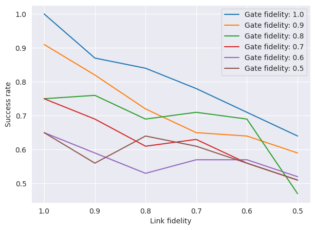
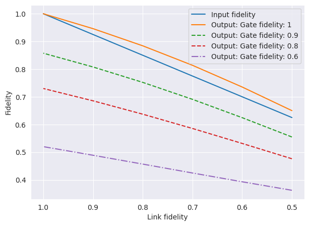
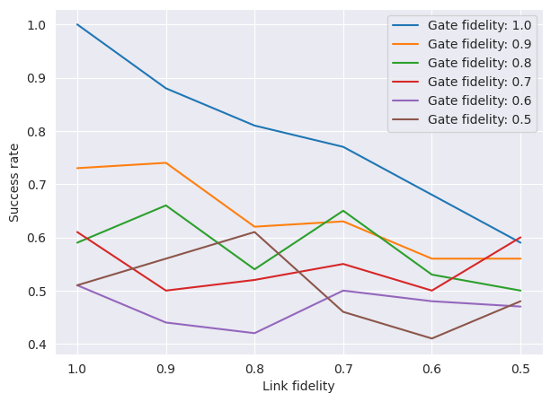
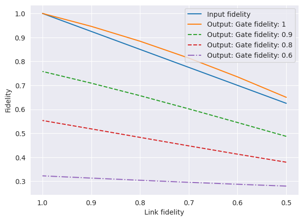
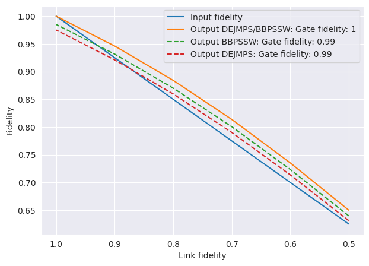
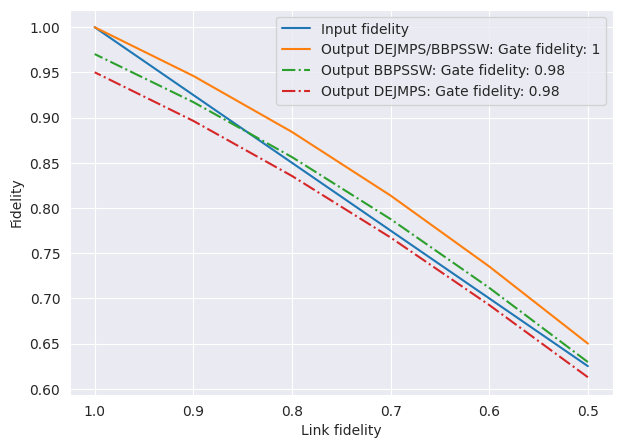
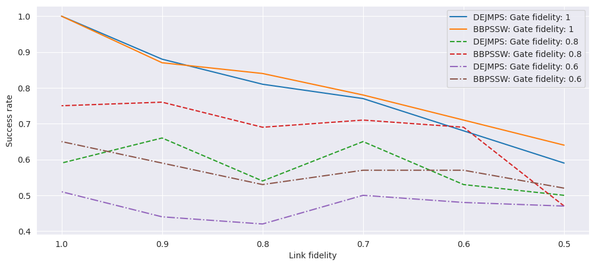
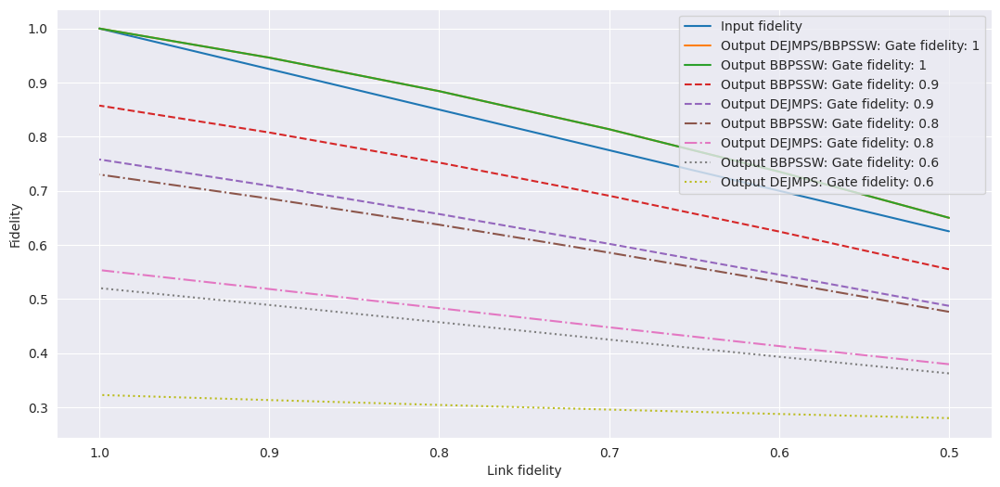
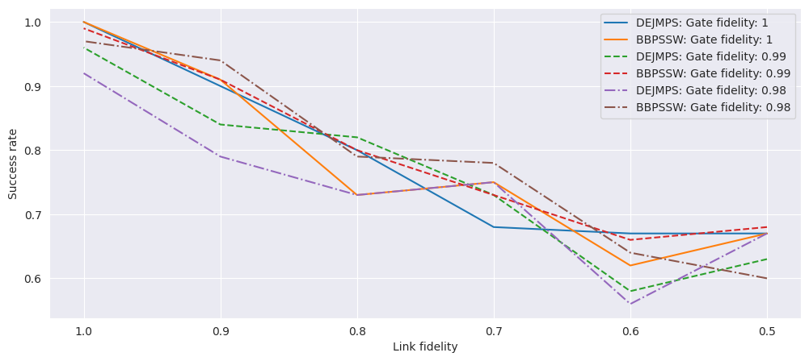

# Investigating the performance of DEJMPS and BBPSSW for isotropic states

## 1. Introduction

We investigates the performance of two prominent quantum communication protocols, DEJMPS (Deutsch et al.) and BBPSSW (Bennett et al.), specifically focusing on their efficacy when applied to isotropic states. Isotropic states, characterized by their symmetry and mixed state properties, are common in practical quantum communication systems due to inevitable environmental interactions. We conduct a comparative analysis of the DEJMPS and BBPSSW protocols to ascertain their efficiency, fidelity, and robustness under varying conditions of isotropic noise and entanglement levels. Through theoretical modeling and simulation, we explore how each protocol performs in terms of entanglement distillation and error correction capabilities. The results indicate distinct advantages in protocol performance based on the initial state properties and the specific requirements of the quantum communication tasks. Our findings provide valuable insights for selecting appropriate distillation protocols in quantum networks and contribute to the optimization of quantum communication strategies under realistic operational conditions.

## 2. Results

### 2.1 BBPSSW
Here we investigate the success rate of BBPSSW over link fidelity and gate fidelity, and the output/input fidelity over link fidelity and gate fidelity. As expected, we can see a gradual decrease in the success rate as gate and link fidelity go down.

  
  

It must be noted that, as gate fidelity decreases, the fidelity of the output state actually falls below the fidelity we would have had if we had not used the protocol.

This shows that the protocol severely deteriorates once we introduce bad quality gates. This is to be expected, since the protocol relies on CNOT gates to distil the entangled states.
### 2.2 DEJMPS
Here we investigate the success rate of DEJMPS over link fidelity and gate fidelity, and the output/input fidelity over link fidelity and gate fidelity. Note that the success rate drops even more rapidly than for BBPSSW, which we will come back to later.

  
  

The same trend continues when we look at the output fidelity. As with BBPSSW, the output fidelity falls below the input fidelity as gate fidelity decreases. However, the decrease in output fidelity is much more drastic than for BBPSSW. This is to be expected, since DEJMPS applies additional unitary rotations to the qubits, which makes gate fidelity play a much larger role.

### 2.3 A Deeper Look into DEJMPS and BBPSSW
Instruments are usually well calibrated. By taking a closer look at instances where the gate fidelity is 99% or 98%, we can better grasp how the protocols behave in a real scenario.

  
  

From the data presented above and in Figure A3, we can see that there are no benefits to using DEJMPS under these circumstances. Even with a slight decrease in gate fidelity, there is a significant gap between the states produced by the two protocols. This is to be expected, since the output fidelity should go down as the number of gate operations increases.

## 3. Conclusion

The objective of this work is to demonstrate that the DEJMPS and BBPSSW protocols are optimally used in different contexts, with an example detailed in section 3. However, this work does not fully address the concept of flexibility. Particularly, in scenarios where the initial state is not a Werner state, the DEJMPS protocol proves to be more efficient and adaptable than BBPSSW. While the additional effort required to generate a Werner state may be inconsequential for certain communication protocols, this work establishes that BBPSSW is more suitable when starting with a Werner state.

## Appendix

Figure A1. DEJMPS vs BBPSSW success rate over link fidelity, for gate fidelities of 1, 0.8 and 0.6.

Figure A2. DEJMPS vs BBPSSW output fidelity over link fidelity, for gate fidelities of 1, 0.9, 0.8 and 0.6, compared with the input fidelity.

Figure A3. More detailed DEJMPS vs BBPSSW success rate over link fidelity, for gate fidelities of 1, 0.99 and 0.98.

## Acknowledgements

All simulations in this work were carried out with NetQASM, developed by QuTech at TU Delft. The BBPSSW protocol was introduced by Bennett, Brassard, Popescu and colleagues, and the DEJMPS protocol by Deutsch and colleagues.
